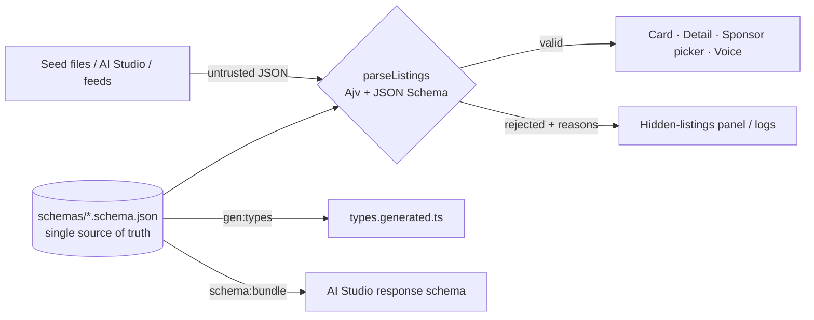

<div align="center">

# Listing Data Contract Lab

**Turn product requirements into a strict, testable data contract, and make sure only validated data ever reaches the UI.**

[](https://github.com/OWNER/REPO/actions/workflows/ci.yml)


</div>

> Replace `OWNER/REPO` in the CI badge with your GitHub path after you push.

## Why this exists

A property card, a detail page, a sponsor picker and a voice assistant all read the same listing. If `price` is sometimes `849000` and sometimes `"$849,000"`, or a ZIP loses its leading zero, something breaks (or speaks nonsense). This repo defines the listing **contract** once, enforces it at the boundary, and proves it with tests, including data generated by an AI model.



## Quick start

```bash
npm ci
npm run dev          # demo UI (switch data source to see invalid records fail safely)
npm run check        # lint + 26 tests + typecheck + build
npm run validate     # validate seed data and cross-record integrity
npm run validate:generated   # report on the two AI Studio runs
```

Requires Node 20+.

## The contract at a glance

| Entity | Primary key | Purpose |
|---|---|---|
| **Property** | `property_id` (`PROP-0001`) | What the listing surfaces render |
| **Sponsor** | `sponsor_id` (`SPN-001`) | A local business and its service ZIPs |
| **PropertySponsor** | `(property_id, sponsor_id)` | Placement rank and dates for one sponsor on one property |

Required on **Property**: `property_id`, `street_address`, `city`, `state`, `zip_code`, `property_type`, `listing_status`, `price`, `bedrooms`, `bathrooms`, `square_feet`, `amenities`, `local_sponsors`.

Constraints: `additionalProperties: false` · `price` positive integer dollars · `bedrooms`/`bathrooms`/`square_feet` non-negative (bathrooms in 0.5 steps) · ZIP is a 5-digit **string** · IDs by pattern · enums for type, status, amenities, sponsor category · max 3 sponsors with unique ranks.

Full entity diagram and the 10 ambiguous business rules I resolved: [`docs/requirements-facts.md`](docs/requirements-facts.md).

## What the tests prove

- One valid record (plus all 5 seed records, 7 sponsors and 14 links) passes.
- **9 invalid fixtures**, each failing for exactly the expected keyword and path: missing ID, negative price, bad ZIP, unknown field, amenity outside the vocabulary, fractional bedrooms, bad bathroom step, too many sponsors, too-short address.
- Cross-record rules that JSON Schema can't express: sponsor exists, serves the ZIP, ranks unique and consistent.
- The UI boundary (`parseListings`) never throws and splits valid from rejected.
- AI Studio run 001 fails with the five documented errors; run 002 passes.

Real output: [`docs/validation/`](docs/validation/).

## Repo map

```text
schemas/                 JSON Schemas (source of truth) + dist/ flattened copies for AI Studio
src/contract/            Ajv validator, generated TypeScript types
src/components/          PropertyCard, PropertyDetail, SponsorPicker, VoiceResponse, RejectedListings
src/lib/                 formatting and voice-response text
data/seed/               5 properties, 7 sponsors, 14 join rows (synthetic)
data/generated/          raw AI Studio runs 001 (errors) and 002 (fixed), synthetic
tests/                   contract tests and invalid fixtures
scripts/                 validate CLI, type generator, schema bundler
docs/adr/001-*.md        decision record: context, decision, alternatives, consequences
docs/                    requirements, AI Studio log, normalization review, RESO mapping, evidence
.github/                 CI, optional Pages deploy, PR and issue templates
```

## Key decisions (short version)

1. **JSON Schema is the single source of truth**; TypeScript types are generated and CI fails on drift.
2. **Validate at the boundary, fail safely.** Bad records are reported, never rendered, never auto-repaired.
3. **Amenities are a controlled enum now**, a join table later (trigger documented).
4. **Fix errors in the right layer**: prompt, response schema, or validator ([table](docs/ai-studio-prompt.md#step-8-which-layer-fixed-each-error)).

Read the full reasoning: [`docs/adr/001-data-contract.md`](docs/adr/001-data-contract.md).

## Docs

| Doc | Lab step |
|---|---|
| [`docs/requirements-facts.md`](docs/requirements-facts.md) | 1–2 |
| [`schemas/`](schemas/) | 3–4 |
| [`docs/ai-studio-prompt.md`](docs/ai-studio-prompt.md) | 5–8 |
| [`src/contract/`](src/contract/) | 9 |
| [`src/components/`](src/components/) | 10 |
| [`tests/`](tests/) | 11 |
| [`docs/normalization-review.md`](docs/normalization-review.md) | 12 |
| [`docs/adr/001-data-contract.md`](docs/adr/001-data-contract.md) | 13 |
| [`docs/pr-description.md`](docs/pr-description.md) | 14 |
| [`docs/ai-collaboration-log.md`](docs/ai-collaboration-log.md) | AI checkpoint |
| [`docs/reso-mapping.md`](docs/reso-mapping.md) | Extension |

## Transparency about AI and data

- **All data is fictional.** No real clients, people, or properties.
- `data/generated/` and `docs/ai-collaboration-log.md` are **simulated stand-ins** for real AI Studio / ChatGPT / Gemini sessions, labeled as such in each file. The checklist in [`docs/evidence/README.md`](docs/evidence/README.md) shows what to replace.
- The RESO mapping is conceptual. This project is **not RESO certified**.

## License

MIT, see [`LICENSE`](LICENSE).
