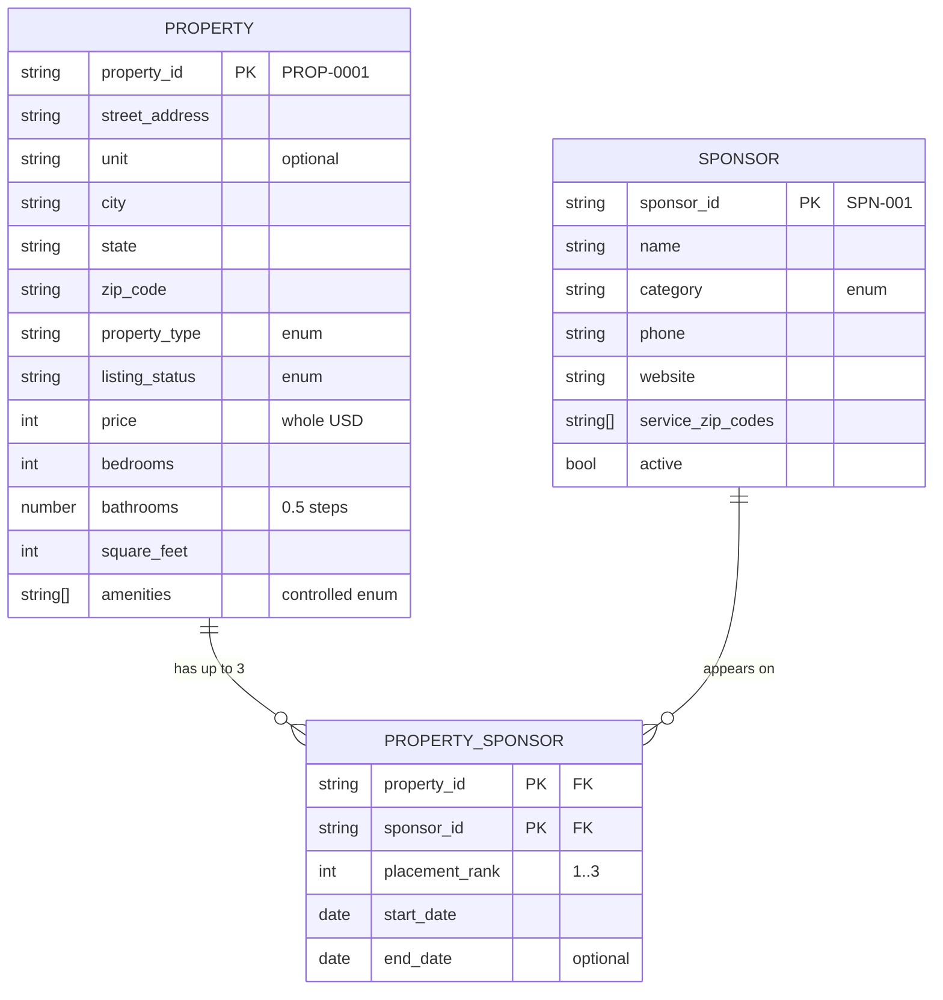

# Step 1–2: Minimum facts and entity model

> All listings, sponsors, phone numbers and websites in this repo are **fictional**. Phone numbers use the reserved `555-01xx` range and websites use `example.com`.

## 1. Minimum facts per surface

| Fact | Property card | Detail page | Sponsor selection | Voice response |
|---|:-:|:-:|:-:|:-:|
| `property_id` (stable key) | ✔ | ✔ | ✔ | ✔ |
| `street_address`, `unit` | ✔ | ✔ | | ✔ |
| `city`, `state`, `zip_code` | ✔ | ✔ | ✔ (ZIP drives which sponsors apply) | ✔ (city, state) |
| `price` | ✔ | ✔ | | ✔ |
| `bedrooms`, `bathrooms`, `square_feet` | ✔ | ✔ | | ✔ |
| `property_type`, `listing_status` | ✔ | ✔ | | ✔ (type) |
| `year_built`, `description` (optional) | | ✔ | | |
| `amenities[]` | | ✔ | | |
| `local_sponsors[]` (`sponsor_id`, `name`, `category`, `placement_rank`) | | ✔ | ✔ | ✔ |

`phone`, `website` and `service_zip_codes` live on **Sponsor**, not on the property: the property surfaces only need enough to render and select a sponsor.

## 2. Entities, keys, relationships

- **Property** owns facts about the home. PK `property_id`.
- **Sponsor** owns facts about the business. PK `sponsor_id`.
- **PropertySponsor** owns facts about the *placement* (rank, dates) that belong to neither side. Composite PK `(property_id, sponsor_id)`.
- `Property.local_sponsors` is a **denormalized read model** (a join already applied) so the UI needs one object per card. The contract tests check that it never disagrees with the Sponsor and PropertySponsor records (`checkReferentialIntegrity`).

## 3. Ambiguous business rules found, and the assumption made

| # | Ambiguity | Assumption in the schema | Where enforced |
|---|---|---|---|
| 1 | Can a price be `0` (e.g. "contact for price")? | No. Price is a positive integer in whole USD. | Schema `exclusiveMinimum: 0` |
| 2 | Are studios `0` bedrooms? | Yes. | Schema `minimum: 0`; UI prints "Studio" |
| 3 | How are half baths stored? | `bathrooms` in steps of 0.5 (2.5 = 2 full + 1 half). | Schema `multipleOf: 0.5` |
| 4 | Must a property have sponsors? | No: key is required, array may be empty. Max 3. | Schema `maxItems: 3` |
| 5 | Must a sponsor serve the property's ZIP? | Yes. | Code (cross-record) |
| 6 | Can two sponsors share a rank on one property? | No. | Code (cross-record) |
| 7 | Is ZIP+4 allowed? | Not in v1; 5 digits only. | Schema `pattern` |
| 8 | Are amenities free text? | No. Controlled vocabulary of 16 values. | Schema `enum` (see ADR) |
| 9 | Should extra fields from AI or feeds be tolerated? | No. They are rejected and reported. | Schema `additionalProperties: false` |
| 10 | Is `sold` a displayable status? | Yes, shown with a distinct badge. | Schema `enum`; UI |
